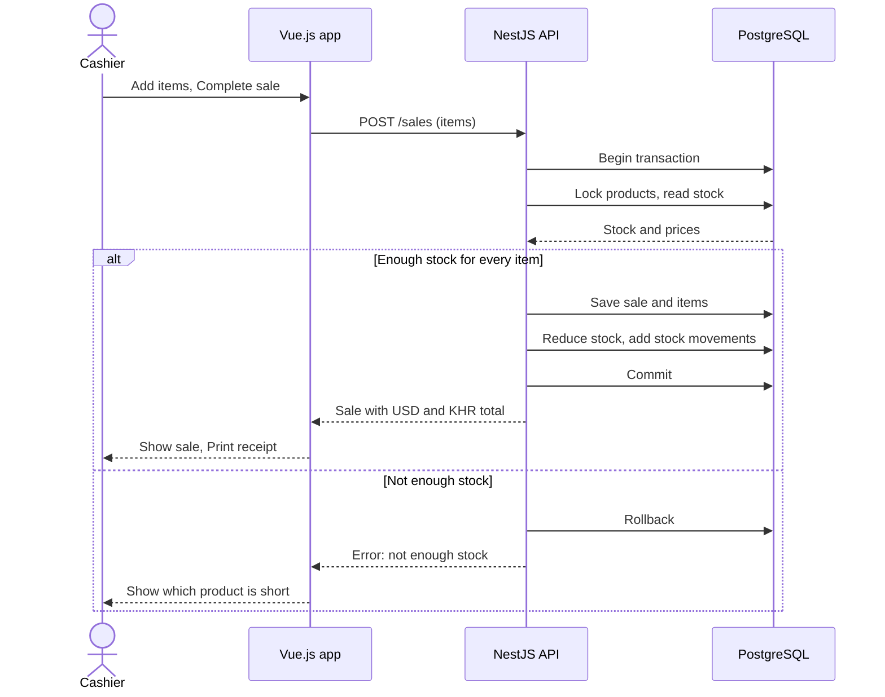

# SmartStock — Small Business Inventory & Sales Management System

## Problem

Small shop owners and employees often track products, stock levels, and daily sales manually using notebooks or spreadsheets, which can lead to inaccurate inventory and missing sales records. This matters because stock errors, unexpected shortages, and incorrect sales calculations can waste money and make it difficult for small businesses to understand their performance.

## Users and roles

- **Shop Owner:** Manages products, employee accounts, stock adjustments, exchange rate, low-stock alerts, and sales reports.
- **Employee/Cashier:** Views products, records customer sales, prints receipts, and checks stock availability.

## User stories

1. As a **Shop Owner**, I want to add, update, and deactivate products so that I can keep my product catalog accurate.

   **Accepted when:** A product can be created with a name, SKU(ID), price, and quantity; required fields and invalid prices are rejected; deactivated products cannot be included in new sales.

2. As an **Employee/Cashier**, I want to record a sale with multiple products so that I can process customer purchases accurately.

   **Accepted when:** A sale can contain multiple products and quantities; the system calculates each line subtotal and the final total correctly in US dollars and Khmer riel using the exchange rate set by the Shop Owner; a sale cannot be completed when a requested quantity exceeds available stock; a plain text receipt can be printed after the sale.

3. As a **Shop Owner**, I want stock quantities to update automatically after a sale so that inventory records remain accurate.

   **Accepted when:** Completing a sale reduces the stock of each sold product; the system records the stock movement; if a sale fails, stock changes are not partially saved.

4. As a **Shop Owner**, I want to adjust stock quantities manually so that I can correct inventory after counting physical products.

5. As a **Shop Owner**, I want to set a low-stock threshold for each product and receive an in-app alert when stock reaches it so that I can restock before products run out.

   **Accepted when:** A threshold can be set per product; when a sale or adjustment brings stock to or below the threshold, an alert is created and shown in the alert bell with an unread count; the same product does not create a second unread alert; the owner can mark alerts as read.

6. As an **Employee/Cashier**, I want to view product details and current stock levels so that I can check product availability before making a sale.

7. As a **Shop Owner**, I want to view sales summaries for a selected date range so that I can understand the shop's sales performance.

8. As a **Shop Owner**, I want to view the details of previous sales and reprint their receipts so that I can review transactions when questions or mistakes arise.

9. As a **Shop Owner**, I want to view stock movement history so that I can understand why a product's quantity changed.

10. As a **Shop Owner**, I want to search and filter products so that I can find products quickly when managing inventory.

## MVP scope

**Must have:** Stories 1, 2, 3, 4, 5, 6, 7, 8, and 9.

**Nice to have:** Story 10 — search and filter products. This can be implemented as a stretch feature if time permits.

## Entities

| Entity | Main attributes | Relations |
|---|---|---|
| User | id, name, email, passwordHash, role, active | A user can record many sales and stock movements. |
| Product | id, name, SKU, description, sellingPrice, stockQuantity, lowStockThreshold, active | A product can appear in many sale items, stock movements, and notifications. |
| Sale | id, saleDate, totalAmount, exchangeRate, status, createdBy | A sale belongs to one user and contains many sale items. |
| SaleItem | id, saleId, productId, quantity, unitPrice, subtotal | Each sale item belongs to one sale and references one product. |
| StockMovement | id, productId, userId, movementType, quantityChange, reason, createdAt | Each stock movement references one product and the user responsible for the change. |
| Notification | id, productId, type, message, read, createdAt | Each notification references one product and is shown to the Shop Owner. |
| Setting | key, value | Stores the exchange rate (KHR per USD). |

## Stretch feature

**Scheduled task — Daily low-stock check**

Once a day the system checks every product against its low-stock threshold. For each product that is still low and has no unread alert, it creates a new alert. The Shop Owner sees these alerts in the alert bell when opening the application, which helps catch products that may run out soon even if no sale happened that day.

## Tech stack

- **Frontend:** Vue.js 3 with Vue Router and Pinia
- **Backend:** NestJS (TypeScript) with JWT authentication
- **Database:** PostgreSQL

## Architecture

The project is built to be easy to change later: NestJS feature modules (auth, users, products, sales, stock, notifications, settings), business rules in services, a stock-changed event that triggers low-stock alerts, database migrations, a versioned and paginated REST API (`/api/v1`), Vue feature folders, environment-based configuration, and Docker Compose for setup.

## Sequence diagram

Recording a sale:

## Repository

https://github.com/haimonyoudom/y3-ip