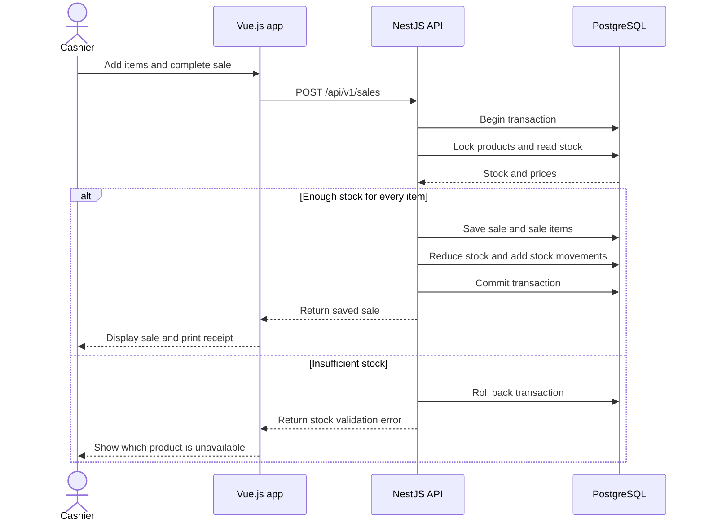

# SmartStock — Small Business Inventory & Sales Management System

## Problem

Small shop owners and employees often track products, stock levels, and daily sales manually using notebooks or spreadsheets, which can lead to inaccurate inventory and missing sales records. This matters because stock errors, unexpected shortages, and incorrect sales calculations can waste money and make it difficult for small businesses to understand their performance.

## Users and roles

- **Shop Owner:** Manages products, employee accounts, stock adjustments, exchange rates, low-stock alerts, and sales reports.
- **Employee/Cashier:** Views products, records customer sales, prints receipts, and checks stock availability.

## User stories

### A. Core inventory and sales stories

**1. Product management**

As a **Shop Owner**, I want to add, update, and deactivate products so that I can keep my product catalog accurate.

**Accepted when:**
- A product can be created with a name, SKU, selling price, and initial quantity.
- Required fields are validated, and invalid prices or duplicate SKUs are rejected.
- Deactivated products cannot be included in new sales.

**2. Record a sale**

As an **Employee/Cashier**, I want to record a sale containing multiple products so that I can process customer purchases accurately.

**Accepted when:**
- A sale can contain multiple products and quantities.
- The system calculates line subtotals and the final total correctly in USD and KHR using the configured exchange rate.
- A sale cannot be completed when a requested quantity exceeds available stock.
- A receipt can be generated and printed after a successful sale.

**3. Automatic stock updates**

As a **Shop Owner**, I want stock quantities to update automatically after a sale so that inventory records remain accurate.

**Accepted when:**
- Completing a sale reduces the stock of every sold product.
- The system records the corresponding stock movements.
- If a sale fails, the sale, stock changes, and stock movements are not partially saved.

**4. Manual stock adjustments**

As a **Shop Owner**, I want to adjust stock quantities manually so that I can correct inventory after counting physical products.

**Accepted when:**
- The owner can increase or decrease stock quantities.
- Every adjustment records the product, quantity change, reason, user, and timestamp.
- An adjustment cannot result in negative stock.

**5. Low-stock alerts**

As a **Shop Owner**, I want to set a low-stock threshold for each product and receive an in-app alert when stock reaches that threshold so that I can restock before products run out.

**Accepted when:**
- A threshold can be configured for each product.
- A sale or adjustment that brings stock to or below the threshold can trigger an alert.
- The system does not create duplicate unread alerts for the same product.
- The owner can view alerts and mark them as read.

**6. View product details and stock**

As an **Employee/Cashier**, I want to view product details and current stock levels so that I can check product availability before making a sale.

**Accepted when:**
- The user can view a product's name, SKU, selling price, and available quantity.
- Deactivated products are clearly identified and cannot be sold.
- Stock quantities reflect completed sales and stock adjustments.

**7. Sales summaries**

As a **Shop Owner**, I want to view sales summaries for a selected date range so that I can understand the shop's sales performance.

**Accepted when:**
- The owner can select a start date and end date.
- The system displays the number of completed sales and total sales revenue for that period.
- Totals are calculated from recorded transactions and use the currency conversion rules consistently.

**8. Sales history and receipt reprinting**

As a **Shop Owner**, I want to view the details of previous sales and reprint their receipts so that I can review transactions when questions or mistakes arise.

**Accepted when:**
- The owner can view previous sales with their dates, totals, and transaction identifiers.
- Selecting a sale displays its products, quantities, prices, and totals.
- The receipt can be generated again from the saved transaction without changing the original sale.

**9. Stock movement history**

As a **Shop Owner**, I want to view stock movement history so that I can understand why a product's quantity changed.

**Accepted when:**
- The owner can view stock movements for a selected product.
- Each movement displays the quantity change, movement type, reason, responsible user, and timestamp.
- The history includes movements caused by sales and manual adjustments.

**10. Search and filter products**

As an **Employee/Cashier**, I want to search and filter products so that I can find products quickly when managing inventory or processing sales.

**Accepted when:**
- Products can be searched by name or SKU.
- Products can be filtered by category and stock status.
- The results update when the search text or filter changes.
- Clearing the search and filters restores the full product list.

### B. Additional user stories

**11. User authentication**

As a **Shop Owner or Employee/Cashier**, I want to log in securely so that I can access the system using my own account.

**Accepted when:**
- A user can log in using valid credentials.
- Invalid credentials are rejected with an appropriate error message.
- Passwords are stored as secure hashes, not plain text.
- Unauthenticated users cannot access protected application features.

**12. Role-based access control**

As a **Shop Owner**, I want the system to restrict features according to user roles so that employees can perform their duties without accessing owner-only functions.

**Accepted when:**
- Shop Owners can access owner-specific management and reporting features.
- Employees/Cashiers can access product information and sales functions permitted by their role.
- Unauthorized actions are rejected by the backend, even if a user attempts to call the API directly.

**13. Employee account management**

As a **Shop Owner**, I want to create, update, and deactivate employee accounts so that I can control who has access to the system.

**Accepted when:**
- The owner can create an employee account with the required information.
- The owner can update employee details and deactivate an account.
- Deactivated employees cannot log in or perform new operations.
- Existing sales records retain the identity of the employee who recorded them.

**14. Product categories**

As a **Shop Owner**, I want to organize products into categories so that I can manage different types of inventory more easily.

**Accepted when:**
- The owner can create and update product categories.
- A product can be assigned to a category.
- Categories can be used to filter products.
- A category containing products cannot be deleted without first handling those product assignments.

**15. Dashboard overview**

As a **Shop Owner**, I want to view a dashboard of key business information so that I can quickly understand the current state of my shop.

**Accepted when:**
- The dashboard displays current product count, low-stock product count, and today's sales summary.
- The dashboard displays recent sales.
- Dashboard values are calculated from recorded inventory and sales data.

**16. Record payment methods**

As an **Employee/Cashier**, I want to record the payment method for each sale so that the shop can track how customers pay.

**Accepted when:**
- The cashier can select a supported payment method, such as cash or bank transfer.
- The selected payment method is saved with the sale.
- The payment method is displayed in the sale details and sales history.

**17. Apply discounts**

As an **Employee/Cashier**, I want to apply an authorized discount to a sale so that I can process permitted promotions or price reductions.

**Accepted when:**
- The cashier can apply a valid discount within the configured limits.
- The system recalculates the final total after the discount.
- The discount amount and final total are saved with the transaction.
- Invalid discounts and discounts exceeding the permitted limit are rejected.

**18. Cancel an eligible sale**

As a **Shop Owner**, I want to cancel an eligible sale so that I can correct transactions entered by mistake.

**Accepted when:**
- The owner can cancel an eligible completed sale with a recorded reason.
- Cancelling a sale restores the appropriate product quantities and records the corresponding stock movements.
- The cancellation and stock restoration are processed consistently.
- The original transaction remains available in the history with its cancelled status.

**19. Export sales reports**

As a **Shop Owner**, I want to export sales summaries so that I can review business performance outside the application.

**Accepted when:**
- The owner can export a report for a selected date range as a CSV file.
- The exported report includes the relevant transaction dates, identifiers, totals, and payment methods.
- The exported figures match the corresponding report displayed in the application.

**20. Product image management**

As a **Shop Owner**, I want to add or update product images so that employees can identify products more easily.

**Accepted when:**
- The owner can add an image to a product.
- The image is displayed in the product list or product details.
- Products without an image display a default placeholder.
- Invalid image types are rejected.

## MVP scope

The MVP will focus on the smallest set of features needed to manage products, process sales, maintain accurate stock, and review transactions.

### Must have

- **Story 1:** Product management
- **Story 2:** Record a sale
- **Story 3:** Automatic stock updates
- **Story 4:** Manual stock adjustments
- **Story 6:** View product details and stock
- **Story 8:** Sales history and receipt reprinting
- **Story 10:** Search and filter products
- **Story 11:** User authentication
- **Story 12:** Role-based access control

### Should have — if time permits

- **Story 5:** Low-stock alerts
- **Story 7:** Sales summaries
- **Story 9:** Stock movement history
- **Story 13:** Employee account management
- **Story 14:** Product categories
- **Story 15:** Dashboard overview
- **Story 16:** Record payment methods

### Future enhancements

- **Story 17:** Apply discounts
- **Story 18:** Cancel an eligible sale
- **Story 19:** Export sales reports
- **Story 20:** Product image management

The MVP priorities should be confirmed with the lecturer. If the project timeline is short, implement and test the must-have stories first before expanding into the should-have and future enhancement features.

## Entities

| Entity | Main attributes | Relations |
|---|---|---|
| User | id, name, email, passwordHash, role, active | A user can record many sales and stock movements. |
| Product | id, name, SKU, description, sellingPrice, stockQuantity, lowStockThreshold, active, categoryId, imageUrl | A product can appear in many sale items, stock movements, and notifications. |
| Category | id, name, description | A category can contain many products. |
| Sale | id, saleDate, totalAmount, exchangeRate, status, createdBy, paymentMethod, discountAmount | A sale belongs to one user and contains many sale items. |
| SaleItem | id, saleId, productId, quantity, unitPrice, subtotal | Each sale item belongs to one sale and references one product. |
| StockMovement | id, productId, userId, movementType, quantityChange, reason, createdAt | Each stock movement references one product and the user responsible for the change. |
| Notification | id, productId, type, message, read, createdAt | Each notification references one product and is shown to the Shop Owner. |
| Setting | key, value | Stores settings such as the exchange rate (KHR per USD). |

**Implementation notes:**
- Story 18 may require cancellation metadata, such as `cancelledAt`, `cancelledBy`, and `cancellationReason`, on the Sale entity.
- Story 17 requires a clearly defined discount rule and a saved discount amount.
- Story 16 adds a payment method to the Sale entity; multiple payment methods per sale are not included in this initial scope.
- Authentication should be enforced by the backend, not just by hiding frontend buttons.

## Stretch feature

### Scheduled low-stock check

Once a day, the system checks every active product against its low-stock threshold. For each product that remains low and has no unread alert, it creates an alert. The Shop Owner sees these alerts in the alert bell when opening the application, helping identify products that need restocking even when no sale happened that day.

## Tech stack

- **Frontend:** Vue.js 3 with TypeScript, Vue Router, and Pinia
- **Backend:** NestJS with TypeScript and JWT authentication
- **Database:** PostgreSQL
- **Testing:** Vitest for frontend unit tests and an appropriate backend testing setup
- **Development environment:** Environment-based configuration; Docker Compose can be used to simplify local setup.

## Architecture

The project uses NestJS feature modules for authentication, users, products, categories, sales, stock, notifications, and settings. Business rules are implemented in services, while PostgreSQL stores persistent data and database migrations track schema changes.

The frontend uses Vue feature folders and reusable components, with props passing data down and events communicating user actions up. Pinia is used for shared client-side state when needed. The backend exposes a versioned REST API under `/api/v1`, with validation, authorization, pagination where appropriate, and transaction handling for sales and stock updates.

A stock-change event can trigger low-stock alert logic. The scheduled low-stock check remains a stretch feature rather than a requirement for the first MVP.

## Sequence diagram

### Recording a sale

## Repository

[https://github.com/haimonyoudom/y3-ip](https://github.com/haimonyoudom/y3-ip)
