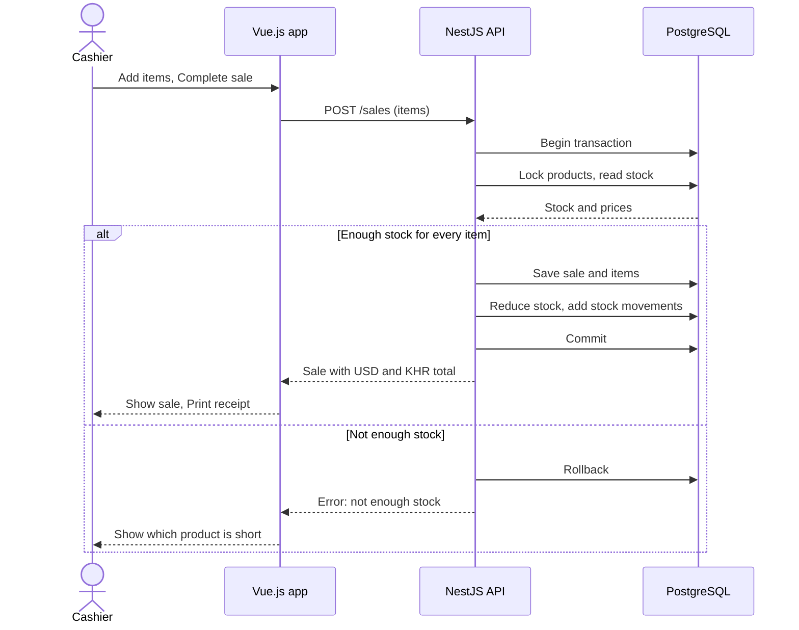

# SmartStock: Software Requirements Specification

Oct 20, 2026 · @haimonyoudom

This SRS defines what SmartStock, a small business inventory and sales management system, must do, so it can be designed, built, and tested. Items marked **Assumption** are my decisions to fill gaps and should be confirmed. Repository: https://github.com/haimonyoudom/y3-ip

## 1. Introduction

### 1.1 Purpose

This document specifies the functional and non-functional requirements of SmartStock. It is written for the developer (solo project), the instructor who reviews it, and the tests that will be derived from it.

### 1.2 Scope

SmartStock lets a small shop manage products and stock, record sales in US dollars and Khmer riel, print plain text receipts, receive low-stock alerts, and review sales and stock history. It does not cover multiple shops, online payments, barcode hardware, customer accounts, tax and discounts, refunds and returns, or a mobile app (Assumption).

### 1.3 Definitions

| Term | Meaning |
| --- | --- |
| SKU | Stock Keeping Unit, a unique product code |
| Stock movement | A record of one change to a product quantity, with its reason |
| Low-stock threshold | A quantity at or below which a product counts as low |
| Alert | An in-app notification that a product is low on stock |
| USD, KHR | US dollar, Khmer riel |
| MVP | Minimum viable product, the must-have features |

### 1.4 Technology

Frontend: Vue.js 3 with Vue Router and Pinia. Backend: NestJS (TypeScript) REST API with JWT authentication. Database: PostgreSQL.

## 2. Overall description

### 2.1 User roles

| Role | Description | Permissions |
| --- | --- | --- |
| Shop Owner | Runs the shop | Manage products, employee accounts, stock adjustments, thresholds, exchange rate, alerts, sales reports, sale details, stock history |
| Employee/Cashier | Serves customers | View products and stock, record sales, print receipts |

### 2.2 Operating environment

Users open the Vue.js frontend in a modern browser (Chrome, Edge, Firefox). The frontend calls the NestJS REST API, which stores data in PostgreSQL.

### 2.3 Constraints and assumptions

- Solo project with a deadline of January 22, 2027 (Assumption: 2027). The first 2 weeks are for learning the stack, the next 11 weeks for building.
- One shop. Product prices are stored in US dollars. Sale totals are also shown in Khmer riel using an exchange rate set by the Shop Owner.
- The first Shop Owner account is created by a seed script. The owner creates employee accounts.
- Stock quantities are whole numbers.
- Every user must log in before using any feature.

### 2.4 MVP and optional features

**Must have:** FR-0 to FR-9, FR-12, FR-13. **Nice to have:** FR-10 (search and filter). **Stretch:** FR-11 (scheduled low-stock check).

## 3. Functional requirements

### FR-0 Authentication and accounts

- FR-0.1 A user can log in with email and password.
- FR-0.2 Passwords are stored only as hashes.
- FR-0.3 The system restricts each feature to the allowed role.
- FR-0.4 The Shop Owner can create, deactivate, and list employee accounts.
- FR-0.5 A deactivated user cannot log in.

### FR-1 Product management (story 1, Shop Owner)

- FR-1.1 The owner can create a product with name, SKU, selling price, and initial quantity. Description is optional.
- FR-1.2 Name, SKU, and price are required. Price must be a number greater than zero. Quantity must be zero or more.
- FR-1.3 SKU must be unique.
- FR-1.4 The owner can update product details.
- FR-1.5 The owner can deactivate a product. A deactivated product cannot be added to a new sale but stays in past sales and history.
- FR-1.6 If an initial quantity is greater than zero, the system records a stock movement for it.

**Accepted when:** a product can be created with name, SKU, price, and quantity; missing required fields and invalid prices are rejected; deactivated products cannot be included in new sales.

### FR-2 Record a sale (story 2, Employee/Cashier)

- FR-2.1 A sale can contain one or more products, each with a quantity of at least 1.
- FR-2.2 Only active products can be selected.
- FR-2.3 The system copies the current selling price into each sale item as the unit price, so later price changes do not alter past sales.
- FR-2.4 The system calculates each line subtotal (unit price x quantity) and the sale total in US dollars. The total is also shown in Khmer riel (see FR-12).
- FR-2.5 The system rejects the sale if any requested quantity is greater than the available stock, and shows which product is short.
- FR-2.6 Each sale records its date and time and the user who created it.

**Accepted when:** a sale can contain multiple products and quantities; line subtotals and the final total are correct; a sale cannot be completed when a requested quantity exceeds available stock.

### FR-3 Automatic stock update (story 3, Shop Owner)

- FR-3.1 Completing a sale reduces the stock of each sold product by the sold quantity.
- FR-3.2 For each sold product the system creates a stock movement of type SALE with a negative quantity change.
- FR-3.3 The sale, its items, the stock reductions, and the stock movements are saved in one database transaction. If any part fails, nothing is saved.
- FR-3.4 Stock must never become negative.

**Accepted when:** completing a sale reduces stock for each sold product; the system records the stock movement; if a sale fails, stock changes are not partially saved.

### FR-4 Manual stock adjustment (story 4, Shop Owner)

- FR-4.1 The owner can set a new stock quantity, or add or remove an amount, for a product after a physical count.
- FR-4.2 A reason is required for each adjustment.
- FR-4.3 The system records a stock movement of type MANUAL\_ADJUSTMENT with the change amount, reason, user, and time.
- FR-4.4 An adjustment cannot make stock negative.

### FR-5 Low-stock threshold (story 5, Shop Owner)

- FR-5.1 The owner can set a low-stock threshold (zero or more) for each product.
- FR-5.2 Products whose stock is at or below their threshold are marked as low stock in the product list.
- FR-5.3 Reaching the threshold creates an alert (see FR-13).

### FR-6 View products and stock (story 6, both roles)

- FR-6.1 Users can view the product list with name, SKU, price, and current stock.
- FR-6.2 Users can open a product to see its details.
- FR-6.3 Cashiers can see this information but cannot change it.

### FR-7 Sales summary (story 7, Shop Owner)

- FR-7.1 The owner can choose a start date and an end date.
- FR-7.2 The system shows the number of sales, total revenue, and total items sold in that range.
- FR-7.3 The system lists the sales in that range with date, total, and cashier.

### FR-8 Sale details (story 8, Shop Owner)

- FR-8.1 The owner can open a past sale to see its date, cashier, items, quantities, unit prices, subtotals, and total.
- FR-8.2 The owner can reprint the receipt from this page (see FR-12).

### FR-9 Stock movement history (story 9, Shop Owner)

- FR-9.1 The owner can view stock movements for a product, newest first.
- FR-9.2 Each entry shows type, quantity change, reason, user, and time.
- FR-9.3 Movement records cannot be edited or deleted through the application.

### FR-10 Search and filter products (story 10, nice to have)

- FR-10.1 Users can search products by name or SKU.
- FR-10.2 Users can filter by active or inactive status and by low stock.

### FR-11 Scheduled low-stock check (stretch feature)

- FR-11.1 A scheduled task runs periodically (Assumption: once per day) and finds products at or below their threshold.
- FR-11.2 For each product still at or below its threshold, the task creates an alert unless an unread alert for that product already exists.
- FR-11.3 The owner sees these alerts in the alert bell (see FR-13) when opening the application.

### FR-12 Currency and text receipt (both roles)

- FR-12.1 Product prices are stored in US dollars (USD).
- FR-12.2 The Shop Owner sets one exchange rate (KHR per USD) in settings. The rate is saved on each sale, so past sales do not change when the rate changes.
- FR-12.3 Every sale total is shown in USD and in Khmer riel (KHR). KHR amounts are rounded to the nearest 100 riel (Assumption).
- FR-12.4 After a sale is completed, the user can print a receipt as plain text (.txt).
- FR-12.5 The receipt shows the shop name, receipt number (sale id), date and time, cashier name, each item (name, quantity, unit price, subtotal), the total in USD and KHR, and a thank-you line.
- FR-12.6 The Shop Owner can reprint the receipt from the sale details page.
- FR-12.7 Receipt lines are fixed width (Assumption: 40 characters) so they print on a small receipt printer or a normal printer.

### FR-13 Low-stock alerts (story 5, Shop Owner)

- FR-13.1 When a sale or a stock adjustment brings a product to or below its low-stock threshold, the system creates a low-stock alert for the Shop Owner.
- FR-13.2 Alerts appear in the app as a bell icon with an unread count, and a list showing product name, SKU, current stock, and threshold.
- FR-13.3 The owner can mark an alert as read. Alerts are kept as history and never deleted.
- FR-13.4 The system does not create a second unread alert for the same product while one is still unread.
- FR-13.5 Alerts are in-app only in the MVP. Delivery is kept separate from alert creation so email or Telegram can be added later (Assumption).

**Accepted when:** a sale or adjustment that brings stock to or below the threshold creates an alert; the bell shows the unread count; the same product does not create a second unread alert; the owner can mark alerts as read.

## 4. Data requirements

| Entity | Main attributes | Relations |
| --- | --- | --- |
| User | id, name, email, passwordHash, role, active | Creates many sales and stock movements |
| Product | id, name, SKU, description, sellingPrice, stockQuantity, lowStockThreshold, active | Appears in many sale items, stock movements, and alerts |
| Sale | id, saleDate, totalAmount, exchangeRate, status, createdBy | Belongs to one user, has many sale items |
| SaleItem | id, saleId, productId, quantity, unitPrice, subtotal | Belongs to one sale, references one product |
| StockMovement | id, productId, userId, movementType, quantityChange, reason, createdAt | References one product and one user |
| Notification | id, productId, type, message, read, createdAt | References one product, shown to the Shop Owner |
| Setting | key, value | Stores the exchange rate (KHR per USD) |

Data rules:

- Email and SKU are unique.
- Roles are SHOP\_OWNER and CASHIER.
- Movement types are INITIAL\_STOCK, SALE, and MANUAL\_ADJUSTMENT (Assumption).
- Notification type is LOW\_STOCK in the MVP (Assumption).
- Sale status is COMPLETED in the MVP (Assumption). The field is kept so voided sales can be added later.
- Money values use a decimal type, not floating point.
- Records are never hard-deleted. Products and users are deactivated instead.

## 5. External interfaces

### 5.1 User interface (Vue.js)

Pages (Assumption): Login, Product List, Product Form, New Sale, Sales List, Sale Details, Sales Summary, Stock Adjustment, Stock Movement History, Employee Management, Settings (exchange rate), Alerts (bell and list). Menu items depend on the user role. Forms show clear validation messages.

### 5.2 REST API (NestJS), planned endpoints

| Method | Endpoint | Purpose | Role |
| --- | --- | --- | --- |
| POST | /auth/login | Log in, receive token | Both |
| GET, POST, PATCH | /users | List, create, update or deactivate employees | Owner |
| GET | /products | List products (search and filter later) | Both |
| GET | /products/:id | Product details | Both |
| POST | /products | Create product | Owner |
| PATCH | /products/:id | Update, deactivate, set threshold | Owner |
| POST | /products/:id/adjust-stock | Manual stock adjustment | Owner |
| GET | /products/:id/movements | Stock movement history | Owner |
| POST | /sales | Create sale (one transaction) | Both |
| GET | /sales | List sales, filter by date range | Owner |
| GET | /sales/:id | Sale details | Owner |
| GET | /sales/:id/receipt | Receipt as plain text | Both |
| GET | /sales/summary | Summary for a date range | Owner |
| GET | /notifications | List low-stock alerts | Owner |
| PATCH | /notifications/:id/read | Mark an alert as read | Owner |
| GET, PATCH | /settings/exchange-rate | Read or change the exchange rate | Owner |

### 5.3 Sequence diagram: record a sale

The cashier completes a sale in the Vue.js app. The NestJS API locks the products, checks stock, and saves the sale, stock changes, and movements in one PostgreSQL transaction. If any item is short, it rolls back and nothing is saved.

## 6. Non-functional requirements

| Category | Requirement |
| --- | --- |
| Security | Passwords hashed with bcrypt. JWT required on all endpoints except login. Role checked on the server for every protected endpoint. |
| Data integrity | Sales and stock changes use database transactions. Foreign keys and unique constraints are enforced in PostgreSQL. |
| Validation | All input is validated on the server (NestJS validation pipes) and on the client. |
| Performance | Common pages load within about 2 seconds with up to 5,000 products and 50,000 sales (Assumption). |
| Usability | A cashier can record a typical sale of three items in under one minute. Layout works on desktop and tablet screens. |
| Reliability | A failed sale leaves no partial data. Errors return clear messages. |
| Maintainability | Code is organized by NestJS feature modules and kept in Git with clear commits (see section 7). |
| Compatibility | Supports current versions of Chrome, Edge, and Firefox. |
| Auditability | Every stock change is traceable to a user, time, and reason. |

## 7. Architecture and scalability

The goal is a project that is easy to change later, not only one that works on demo day. These rules apply from the first line of code.

- **Feature modules in the backend.** NestJS code is split into modules: auth, users, products, sales, stock, notifications, settings. Each has a controller (HTTP only), a service (business rules), and entities (database).
- **Business rules in services.** Totals, stock checks, and riel rounding live in services, never in controllers or Vue components, so they can be tested and reused.
- **Events for side effects.** When stock changes, the stock module emits a stock-changed event. The notifications module listens and creates low-stock alerts. New features such as email or reports can listen to the same event without editing the sales code.
- **Delivery behind an interface.** Alerts go out through a notifier interface. The MVP has in-app alerts only, and email or Telegram can be added later as another implementation.
- **Feature folders in the frontend.** Vue code is grouped by feature (products, sales, stock, alerts) with a shared API layer, Pinia stores, and reusable components. Routes are lazy-loaded.
- **Database discipline.** Schema changes use migrations, not automatic sync. Indexes cover SKU, sale date, and the product column of stock movements.
- **Stable API.** Endpoints live under /api/v1, validate input with DTOs, return one consistent error format, and paginate list endpoints (products, sales, stock movements, alerts).
- **Configuration and setup.** Settings come from environment variables. Docker Compose starts the API and PostgreSQL the same way on every computer (Assumption).
- **Stateless API.** JWT login keeps no server session, so more API instances can run behind a load balancer later.
- **Tests as a safety net.** Unit tests cover the money and stock rules, and one end-to-end test covers the full sale flow.

## 8. Testing and acceptance

- Each requirement's **Accepted when** conditions become test cases.
- Unit tests cover total calculation, riel rounding, and stock rules.
- API tests cover role restrictions, the failed-sale rollback, and alert creation.
- Manual tests cover the main flows for both roles.
- The MVP is accepted when FR-0 to FR-9, FR-12, and FR-13 pass all their acceptance conditions.

